# Multiview Blockout 2 Real

**Turn any grey 3D scene into the same scene textured from several calibrated views of one generated photoreal
multi-view sheet, written back into each object's own UV textures, so it still holds up when the camera moves.**
A skill for coding agents (Claude Code, Codex, Cursor, Copilot, Gemini) that renders exact clay views and passes
from N cameras, asks an image model for all of them in one multi-reference edit, measures how far the generated
views agree with each other, fuses them into every object's UV atlas with visibility tests, and ends in two
`.blend` files: a baked-appearance diagnostic that says it contains lighting, and an editable, relightable PBR
scene.

The next step after [Video 2 GLSL](https://github.com/gokayfem/shader-skills),
[Video 2 Blender Nodes](https://github.com/gokayfem/video-to-blender),
[Video 2 Physics](https://github.com/gokayfem/video-to-physics),
[Video to CSS](https://github.com/gokayfem/video-to-css),
[Image 2 Sculpt](https://github.com/gokayfem/image-to-sculpt) and
[Blockout 2 Real](https://github.com/gokayfem/blockout-to-real). Blockout 2 Real gives a grey scene real
materials and light from one fixed camera, and its README lists several cameras as out of scope: from a moved
camera its fills show. This one takes the same kind of scene and textures it from several cameras at once, and
reports how much of each object was seen and how much is inferred.

<p align="center">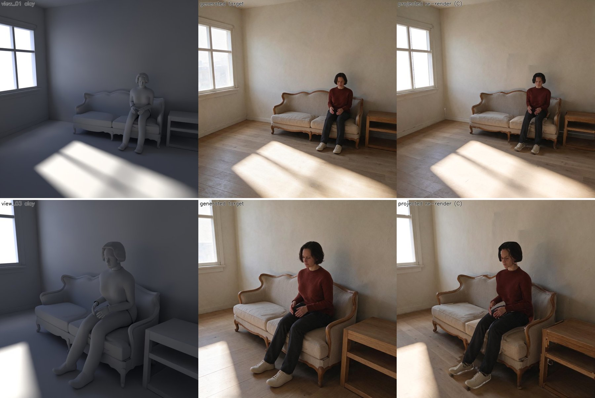</p>

<p align="center"><sub>Two of the six views of the first run: clay render (left), generated target (middle), Blender re-render of the scene after multiview projection (right; the baked-appearance diagnostic). Over the six source views the re-render's observed pixels are 27.0 dB PSNR from their targets. A careful viewer sees it: the hair is a smooth shell, the shoes are painted onto a shoe shape that differs a little from the generated one, the floor sun patch is baked into the texture, and a few faint rectangles remain on the back wall. The woman is a fictional person generated for the run, not a real individual.</sub></p>

## Why

Ask an agent to "make this scene look real from every angle" and it usually generates one picture per camera
and pastes each onto the geometry. Each picture looks fine; the scene does not. The usual failures go unnoticed:

- each view is generated on its own, so the same sofa gets a different weave, the same floor different boards,
  the same face a slightly different person, and nobody measures how much the views disagree;
- the image model returns a different size than was asked for, the response does not say so, and a resize is
  later reported as generated detail;
- texels are painted from views that cannot see them (occluded, grazing, off the generated object's edge), so
  background and neighbours leak onto geometry;
- views are averaged where they disagree, and fabric turns to blotches and faces get double features;
- the fusion is judged by how well each source view is reproduced, which every method does well, because each
  view is rebuilt from itself;
- shading from the generated photos becomes "albedo", the scene is called relightable, and a sun patch stays on
  the floor after the sun moves;
- a 360° fly-through is shown with no word on how much of it was ever seen by a camera.

This toolkit gives the agent a method and the tools to do it properly:

- **Calibrated views with exact passes.** Every camera renders a clay view plus object ids, camera-axis depth,
  world position and normals, and the numbers are checked: reprojection error, depth against camera-axis Z (not
  ray length) and a cross-check against Blender's own pass.
- **All views in one call.** The clay views are tiled into one grid of exact cells and sent with the reference
  images and every full-resolution clay view in a single multi-reference edit, so the model generates the views
  together. The size it really returned is read from the file.
- **Refined per view, accepted by a fixed rule.** Each cell gets a high-resolution edit (clay view + cell + grid
  + references). It is kept only if silhouette overlap, contour distance, landmark offset and colour drift pass
  thresholds written down before looking; otherwise the cell is kept, and its resize is labelled as a resize.
- **Agreement is measured before fusing.** A projector-free score maps every pixel of one view into every other
  through the known geometry and reports, per object, a low band (lighting and colour) and a high band (do the
  invented details line up).
- **Visibility-aware fusion into each object's UV atlas.** Every texel is tested in every view (behind,
  off-image, back-facing, grazing, occluded, wrong object, too close to an edge, low alignment confidence) and
  sampled only inside the generated mask of its own object, eroded, with every other object's mask rejected and
  a margin kept around every nearer silhouette. A detail-critical region (a face, a hand) takes one camera, and
  a second camera starts only after a gap. Several fusion methods run on identical inputs.
- **Scored where it matters.** Leave-one-view-out (fuse from the other views, predict the held-out one), seam
  visibility in texture space and in novel views, and a count of texels that took another object's pixels, next
  to per-object coverage.
- **Optional repair rounds.** A render-then-refine round lets the image model clean up the projected re-renders
  so the views share one layout, kept only if the agreement score improves; a silhouette-carving refit fixes
  geometry such as hair that is larger than what was generated.
- **Two honest outputs.** A diagnostic `.blend` with the projected appearance (it contains lighting and says so)
  and a PBR `.blend` whose base colour is the projected photo times a smooth correction, with Principled
  materials and a light rig fitted to the targets. The residual baked shading is measured and reported.
- **Reviewed at full size, on fixed boxes.** `critique` packs native-resolution crop strips for a fresh
  reviewer on boxes that are reused in every later round. Acceptance is its verdict per crop; in the first run
  a reduced-size sheet hid a failing head and hands. A fix round is kept only if it is no worse on the scores
  and better on those crops.
- **Measured versus inferred, everywhere.** Coverage per object, inferred surfaces kept plain and labelled, and
  a tour (a 360° pan inside an enclosing room, an orbit around an object or product scene) rendered a second
  time with every inferred pixel tinted.

## Any input

| Input | What happens |
|---|---|
| A `.blend` with several cameras | the main path: a grey copy with one non-overlapping UV map, a stable id and a description per object; the cameras are kept |
| A `.blend` with one or no camera | cameras are placed automatically (an arc of views around the subject, an optional close-up on a named object, an optional elevated wide); check the preview sheet and the per-object coverage table |
| glTF/GLB, OBJ, FBX, USD, PLY, STL | imported, one object per mesh (`--group-by`), then the same |
| A JSON scene spec of primitives | built in Blender, cameras from the spec or automatic |
| Only an idea | the agent writes the spec first |
| Reference images (a character, a product, a material, a style) | sent as extra references with a stated role; never used as geometry |
| Your own photoreal images of exactly these views | `targets --images`: generation is skipped; everything downstream runs offline |
| Another image model | a fal multi-reference edit endpoint set in `case.json` `model`. `probe` reads schemas shaped like Seedream's (an `image_size` parameter taking `{width, height}` and an image-URL list); for other schemas it refuses and asks for `model.pixel_cap`, `model.max_refs` and size-parameter overrides in `case.json` |
| Any number of views (2 to 9) | grid rows x cols chosen automatically; cell size from the verified pixel cap |
| No API key | the generation stages are unavailable; `targets --images` and `--generator mock` (an offline synthetic image model for tests and demos) work |

After scaffolding, the agent writes the case's `look`, the role of each reference image, and every object's
description and material class in `case.json` itself; nothing about a particular scene, subject, prompt, number
of views or image model lives in this repository. Out of scope, and said before starting: glass, mirrors and
other view-dependent materials; thin foliage and hair strands as geometry; animation; whole-room or 360° claims
beyond what the cameras see; exact identity preservation; relightable albedo free of baked shading.

## Install

**Claude Code** (plugin marketplace):

```bash
claude plugin marketplace add gokayfem/multiview-to-real
```

```bash
claude plugin install multiview-to-real@multiview-to-real
```

Or copy the skill: `cp -R skills/multiview-to-real ~/.claude/skills/`.

**Codex, Cursor, Gemini CLI, Copilot and other agents** (via [skills](https://github.com/vercel-labs/skills)):

```bash
npx skills add gokayfem/multiview-to-real
```

Or install by hand:

- **Codex:** copy `skills/multiview-to-real` to `~/.agents/skills/`.
- **Cursor:** copy it to `~/.cursor/skills/`, plus the rule in `adapters/cursor/`.
- **Copilot:** `gh skill install gokayfem/multiview-to-real multiview-to-real`, plus `adapters/copilot/`.
- **Gemini CLI:** `gemini extensions install https://github.com/gokayfem/multiview-to-real`.

**claude.ai:** zip `skills/multiview-to-real` and upload it under Settings > Capabilities > Skills.

**ChatGPT, Gemini Gems and other chat tools:** see [`adapters/`](adapters/).

Requirements: Python 3.10+ with `numpy`, `scipy`, `scikit-image`, `Pillow`, `opencv-python-headless` and
`fal-client` (`pip install -r requirements.txt`), Blender 4.2 or later, checked at start-up (developed and tested on 5.0.1; `$BLENDER`, `blender` on PATH, or the macOS app; `$MVB2R_BLENDER_TIMEOUT` sets the time limit of a Blender call)
for every geometry, pass and render stage, ffmpeg for the videos (without it the frames are kept and the
stage says so), and a fal API key in `FAL_KEY` for the
generation stages. `python3 skills/multiview-to-real/scripts/mvb2r.py doctor` checks all of it (the key
is never printed).

Platforms: developed and tested on macOS with Blender 5.0.1. Linux is expected to work (CI runs the
offline tests on Ubuntu, without Blender). Windows is untested.

## Use

Ask naturally, for example:

- *"Make this blockout look real from all its cameras: `attic.blend`."*
- *"Here is a grey room with a seated figure and a photo of the person. Texture it from six views so I can move
  the camera."*
- *"Put cameras around this product GLB, generate a studio look, and give me a relightable `.blend`."*
- *"I painted these four views myself. Project them into the scene and tell me how much is covered."*

The agent scaffolds a case, writes the look, the reference roles and the object descriptions, looks at every
sheet, and runs the stages:

```bash
python3 skills/multiview-to-real/scripts/mvb2r.py new cases/attic --input attic.blend --look "sunlit attic study, oak beams, late afternoon" --views 6
python3 skills/multiview-to-real/scripts/mvb2r.py run cases/attic --to targets
```

`run` chains the stages in order within the case budget. Each stage also runs on its own:

| Command | What it does |
|---|---|
| `doctor` | Python packages, Blender, `FAL_KEY` (never printed) |
| `new CASE --input X [--look …] [--views N] [--closeup OBJ] [--reference IMG=role[:obj,…]] [--group-by …] [--resolution PX] [--generator fal\|mock] [--max-calls N] [--edit-endpoint ID] [--no-cameras] [--allow-external-images]` | scaffold: ingest any input, grey copy, UV audit and overlap fix, ids, placeholder descriptions; a failed `new` leaves `case.failed.json` and can simply be re-run; keeps the scene's cameras when it has at least two and `--views` is not given, else places an automatic rig (6 views by default) |
| `cameras CASE [--replace] [--count N] [--closeup OBJ] [--arc DEG] [--no-elevated]` | (re)place automatic cameras, preview sheet, per-object coverage (seen by at least one / at least two views) |
| `views CASE [--samples N] [--resolution PX] [--verify-only]` | clay beauty and exact passes per camera, `cameras.json`, numeric verification (reprojection px, `depth_z` against ray length, Blender cross-check) |
| `grid CASE` | exact rows x cols grid, `layout.json`, ordered references manifest (sheet, case references, one clay copy per view), distinctness check |
| `probe CASE [--schema-file F] [--check-size]` | fetch the endpoint's schema, record parameters, reference limit and pixel cap in `gen/model.json`; `--check-size` spends one call to check the returned size |
| `generate CASE` | one multi-reference grid edit at the largest verified native size; seam detection; cell extraction; QA |
| `refine CASE [--views …]` | per-view high-resolution edits (clay view, cell, sheet, case references), fixed acceptance rule, fallback to the cell |
| `targets CASE [--images DIR]` | freeze the targets: resample to the calibration resolution (never called new detail), alignment confidence, per-object generated masks, `targets.json`; or take your own `view_XX.png` images |
| `consistency CASE [--set NAME=PATTERN] [--views …]` | projector-free cross-view reprojection score: low band (lighting and colour) and high band (do invented details line up), per object; any image set can be scored |
| `project CASE [--method NAME\|all]` | visibility-aware multiview fusion into each object's UV atlas, all maps, `coverage.json`, `diagnostic.blend`, consensus re-renders, novel views |
| `score CASE [--methods …] [--no-loo]` | leave-one-view-out (on an evaluation mask that does not depend on the gate policy), seam visibility, sharpness retention, leak (texels that took another object's pixels), alignment, coverage; contact sheets per view and method |
| `resync CASE [--method NAME]` | opt-in render-then-refine round on the consensus re-renders (one paid call per view); new targets kept only if `consistency` improves and alignment holds, after which `consistency`, `project`, `score`, `pbr` and `render` must be re-run |
| `refit CASE [--object NAME] [--mode solid\|shell] [--apply]` | silhouette carving of `refit` objects to their generated masks into a new `blockout_refit.blend`, before/after IoU per view; `--apply` keeps the old blockout as `blockout_pre_refit.blend` (and refuses if that file exists) and switches the case to the carved one |
| `pbr CASE [--synth-direct]` | shading basis under the scene's own lights, conservative de-light that keeps projected detail, Principled materials, rig fit to target luminance, `final.blend`; `--synth-direct` (opt-in, surfaces named in `pbr.synth_objects`) replaces the generated photo's own direct-light patch on those surfaces with texture copied from the shaded part of the same object, marked inferred |
| `render CASE [--move] [--tour] [--relight] [--frames N] [--scale S] [--samples N]` | source views, novel views and a camera move between neighbouring cameras (a pair with no valid in-between camera is skipped with a note), a tour (360° pan for enclosing rooms, orbit for object scenes; the mode is in `out/tour.json`) and its coverage-tinted copy with measured/inferred fractions, relight comparison (`out/relight.json`) |
| `critique CASE [--round NAME] [--new-boxes] [--save FILE]`, `report CASE` | pack sheets and native-resolution crop strips on fixed, reused boxes for a fresh reviewer, one folder per round, and store its per-crop verdicts; write `out/report.md` (method table, native vs resized sizes, calls, leak, measured vs inferred, review rounds, limits) |
| `run CASE [--from STAGE] [--to STAGE] [--resync] [--schema-file F]` | views, probe, grid, generate, refine, targets, consistency, project, score, pbr, render, report, in that order within the budget (`probe` is skipped for the mock generator); `resync` only with `--resync`; `cameras`, `probe --check-size`, `refit` and `critique` are run by hand; `logs/run_summary.json` lists what ran and any STALE outputs (refresh with `run CASE --from project`) |

Every paid call goes through the case budget and is logged in `gen/calls.jsonl` with the endpoint, sanitised
arguments, input hashes, the dimensions read from the returned file and a cost note. `budget.max_calls` (or
`--max-calls`, or `MVB2R_MAX_CALLS`) counts every started call, failed ones included; cache hits are free, a call
that would exceed the budget is refused before it starts, and nothing is retried automatically. A `$0` price in
an endpoint's documentation is recorded as unknown, never as free.

## How a case runs

| Phase | Deliverable | Checked by |
|---|---|---|
| Scaffold | `case.json` with look, references, object descriptions and classes; `blockout.blend` | a person reads the descriptions; the UV audit reports 0 overlapping texels |
| Cameras and views | clay views, ids, `depth_z`, position, normals, `cameras.json`, preview and coverage sheets | reprojection and depth checks in `views/verify/`; the agent looks at the coverage table |
| Probe and grid | `gen/model.json`, the grid, `layout.json`, the ordered references manifest | the schema's parameters, reference limit and pixel cap; distinct references; optionally the size the endpoint really returns (`probe --check-size`) |
| Generate and refine | the multi-view sheet, cells, per-view refinements | seam positions, silhouette IoU, contour distance, landmark offset, colour drift; the agent looks at every crop |
| Targets | frozen `view_XX.png`, `align_conf_XX.png`, `mask_<object>_XX.png`, `targets.json` | native vs resized recorded per view |
| Consistency | per-object low-band ΔE and high-band correlation | numbers against a one-texture consensus |
| Project and score | UV textures, source, confidence, coverage and unobserved maps, `diagnostic.blend`, `score.json` | leave-one-view-out, seam visibility, coverage; the agent looks at re-renders and novel views |
| Resync, refit (opt-in) | new targets; carved geometry | kept only if the score improves and alignment holds; everything downstream re-run |
| PBR | de-lit textures, materials, fitted rig, `final.blend` | residual shading correlation, luminance ratio per view, the relight sheet |
| Render and report | renders, novel views, camera move, tours, `relight.jpg`, `report.md` | a fresh reviewer that sees only the images |

## The first run

One room (4.5 x 4 x 2.7 m) with a sofa, a side table, a window and one seated person, six cameras at 1664 x
1664 (frontal wide, two three-quarter views, a face close-up, a side view, an elevated wide), Seedream 5.5 edit
on fal, Blender 5.0.1 and Cycles on a Mac. The person is CC0 MakeHuman geometry posed through MPFB; the sofa and
side table are CC0 Poly Haven models. The run is where every rule below comes from; its numbers are from its
own reports.

<p align="center">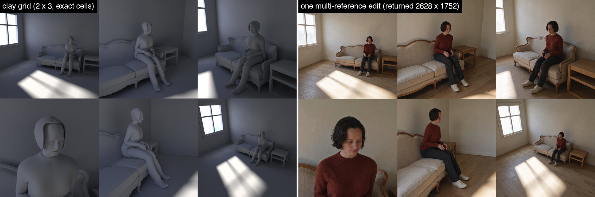</p>

<p align="center"><sub>The clay grid (left) and the one multi-reference edit (right): grid, character reference and the six full-resolution clay views in one call. The edit was asked for and returned at 2628 x 1752; every panel seam landed within 2 px of the ideal 876 px grid. Each 876 px cell was then refined on its own at 2144 x 2144.</sub></p>

**Sizes.** Asked for 4992 x 3328 (16.6 MP), the edit endpoint returned 2504 x 1672 without an error; the
response reported null dimensions. The largest size returned natively was 2628 x 1752 (99.6% of the documented
4,624,220-pixel cap). The six per-view refinements were asked for and returned at 2144 x 2144 and downsampled to
1664 x 1664 for projection; projection samples the native 2144 images.

**Acceptance.** Fixed before looking: person IoU no more than 0.03 below the cell's, contour distance at most 12
px, head-top offset at most 10 px, colour drift at most 8 ΔE, and a visual pass. One of six refinements failed
(IoU 0.883 against a floor of 0.889, head 11.5 px too low); its retry passed. Final person IoU against the clay
was 0.837 to 0.969 across views.

**Agreement between views.** Over all 30 ordered view pairs (34.2 M pixel samples), the independently refined
targets agreed on lighting and colour to 5.19 ΔE (low band) and on fine detail to a high-band correlation of
0.161. A re-render of one shared texture scores 0.947 on the same measure. One render-then-refine round brought
the low band to 3.38 ΔE (35% better) and the high band to 0.244; floor boards went from 0.207 to 0.489. Linen
weave (0.145 to 0.173), knit (0.058 to 0.059), table grain (0.224 to 0.220) and hair stayed view-specific, and
shoes got worse (4.79 to 6.09 ΔE).

<p align="center">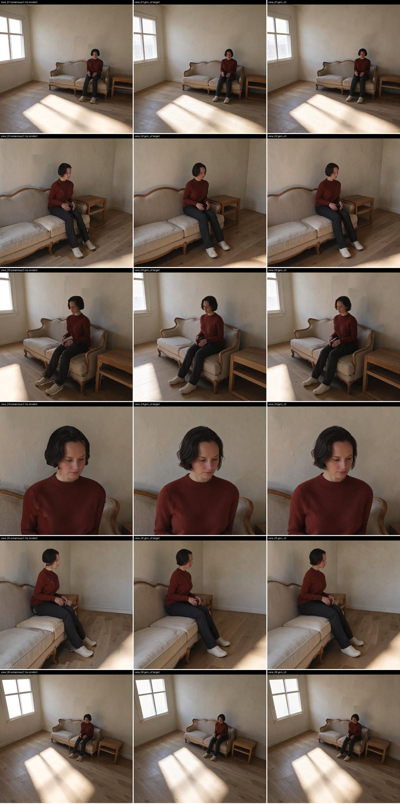</p>

<p align="center"><sub>The render-then-refine round. Left: the projected scene re-rendered from each camera (one shared texture, with its smears and seams). Middle: the first targets. Right: the image model's repair of the left column, kept because the cross-view score improved and alignment held in every view. The projections and PBR results below were built from the first targets (middle); the round was measured, not yet projected.</sub></p>

**Fusion.** Three methods ran on identical frozen inputs: best single view per region (A, `best`), an
agreement-gated blend (B, `blend`) and seam-aware labelling with per-object gain levelling (C, `regions`). On the six source views they are almost
the same (observed-pixel PSNR 27.6, 27.6 and 27.0 dB), because each view is rebuilt mostly from itself. Seam
visibility does separate them (seam step to interior step, source / novel views: A 6.3 / 6.4, B 4.1 / 4.0, C 5.5
/ 5.7), and so do the crops: A pastes one view's sun-patch polygon and a person's shadow into other views, B
blends linen and plaster into blotches, C keeps one source per region and was the default.

**Seam bake-off.** Every candidate was then scored on the same frozen targets by leave-one-view-out (fuse from
five views, predict the sixth, PSNR on pixels the other views observed, pixel-weighted) and by the coarse seam
step in four novel views (in 8-bit levels), with sharpness retention as a floor against blurring. Means over
floor, back wall, sofa, knit top and skin; first target set, then the consistency-round set:

| Method | LOO PSNR (dB) | Novel-view coarse seam step | Sharpness (first set) |
|---|---|---|---|
| best view (A) | 25.02 / not run | 6.54 / not run | 0.83 |
| labelling + levelling (C, `regions`) | 25.57 / 27.92 | 5.31 / 4.76 | 0.76 |
| **C labels for the high band + low band blended at σ 8 px (winner)** | **25.64 / 28.17** | 4.49 / 4.29 | 0.75 |
| best view + low band blended at σ 16 px | 25.58 / 28.11 | 4.47 / 4.04 | 0.79 |
| 4-band multi-band | 25.52 / 28.05 | 4.43 / 4.26 | 0.74 |

The winner keeps one source view per region for the detail and blends only the smooth lighting and colour. It
wins clearly on plaster (+0.7 dB, seams about 30% lower) and on the floor (+0.5 dB on the first set, +0.4 dB on
the second); it ties on linen on the first set and gains 0.9 dB on the second; on the knit top plain labelling
was better on the first set and the split on the second; face and hands are single-source and within 0.1 dB.
Graph-cut seam placement added nothing over the split, the gated blend blurs (sharpness 0.61), and registration
to the consensus gave no real gain at 3 to 10 times the time. The limit is the generated detail itself: in
leave-one-view-out, the predicted fine detail correlates with the held-out view at only 0.02 to 0.03 on knit,
0.04 to 0.07 on plaster, 0.12 to 0.17 on linen and 0.14 to 0.39 on the floor; the consistency round raised the
floor's from 0.14 to 0.39. Fusion cannot make invented detail agree. The second set was refined from a fused
re-render of the first, so its absolute numbers are optimistic; rankings within a set are fair.

<p align="center">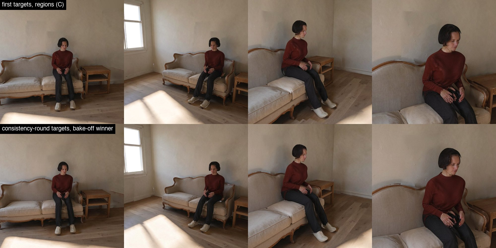</p>

<p align="center"><sub>Four viewpoints between the source cameras, where no target exists. Top: labelling (C) on the first targets. Bottom: the bake-off winner on the consistency-round targets. The rectangular patches on the back wall and the staircase on the floor near the feet are gone. The hair is still a smooth shell, and the hands are smeared in the closest view.</sub></p>

<p align="center">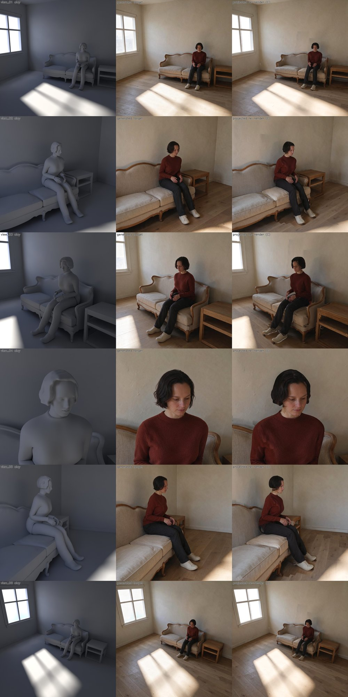</p>

<p align="center"><sub>All six views: clay, target, re-render of the diagnostic scene (method C). The face is taken from the close-up only, each hand and shoe from one view, so they are never blended. Unless a caption says otherwise, every re-render in this README (this sheet, the hero, the hair refit, the relight and the tour) shows method C on the first target set; only the novel-view comparison above shows the bake-off winner.</sub></p>

**Geometry decides realism.** The first blockout had a primitive mannequin and a box sofa, and every generated
view looked like a CG render. Rebuilt with CC0 MakeHuman geometry and Poly Haven furniture, with the contact
measured (soles 1.1 to 1.7 mm above the floor, hands 2.2 to 3.4 mm above the thighs), the same kind of prompt
gave photographic views. The image model follows the clay pose faithfully, so the pose and contact have to be right
in the blockout.

<p align="center">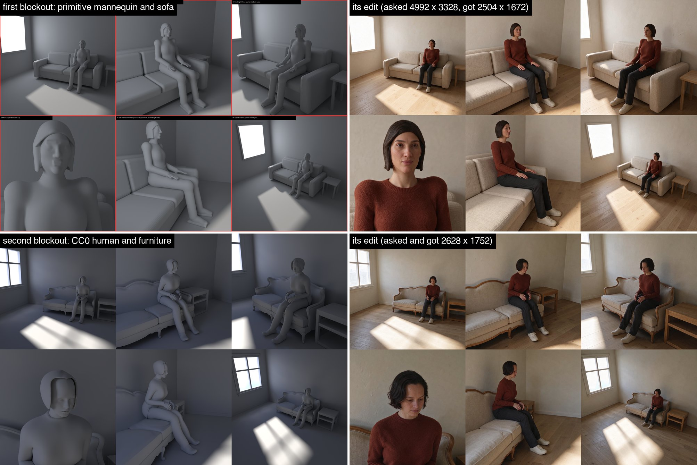</p>

<p align="center"><sub>Top: the first blockout and its edit (asked for 4992 x 3328, silently returned at 2504 x 1672), CG-looking. Bottom: the asset-based blockout and its edit. The hair shell in the bottom clay is still the oversized one that was refitted later.</sub></p>

**Refit.** The hair shell was larger than the generated bob, and from every angle it rendered as a helmet with
skin-coloured patches. Carving it to the generated hair masks of the six views raised the hair IoU from 0.55 to
0.75 in the frontal wide view and from 0.63 to 0.84 in the elevated wide view (one view went down, 0.85 to
0.82), and the close-up's hair PSNR from 18.1 to 24.2 dB.

<p align="center">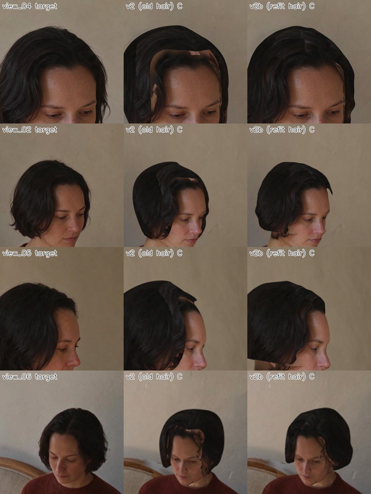</p>

<p align="center"><sub>Target (left), the projection on the original shell (middle; skin patches and a helmet outline), and on the shell carved to the generated hair masks (right). What remains: a smooth shell with no strands, a flick of shell at one side in view 02, a thin skin line at the hairline.</sub></p>

**PBR.** The base colour is the projected photo times a smooth, clamped correction, never a material prior; an
earlier version that replaced texture with priors looked like plastic. Residual baked shading: the correlation
of albedo luminance with the proxy shading is 0.28 (0.59 in the raw targets), and the floor sun patch is 1.4 to
2.0 times brighter than its surroundings in the albedo (5.5 to 8.8 in the photos). The light rig is the
blockout's own sun and sky, scaled and white-balanced against the targets: mean luminance ratio 0.98 to 1.04 in
five views, 0.87 in the face close-up. PBR re-renders are 23.8 dB PSNR from the targets on average, the
diagnostic 26.2 dB; the diagnostic is the target colour by construction.

<p align="center">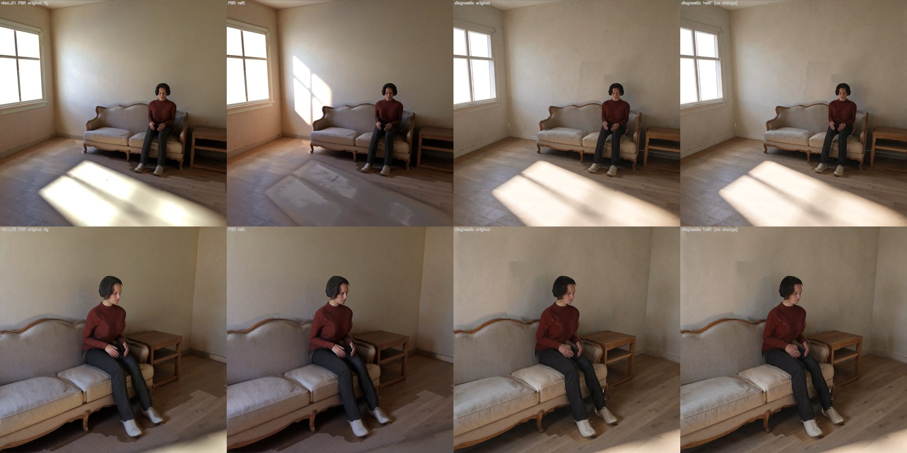</p>

<p align="center"><sub>Relit with the sun moved 70° in azimuth. PBR (first two columns): in view 01 the old floor patch collapses (contrast 7.9 to 1.2) and the light lands on the wall; a pale ghost of the old patch remains on the floor. In view 02 the contrast only drops from 6.4 to 4.1. The diagnostic scene (last two columns) does not change at all, which is the point of keeping the two apart.</sub></p>

**Coverage.** Area-weighted over each mesh's surface, the cameras observed 24% of the floor, 41% of the sofa,
28% of the back wall, 1% of the ceiling, 0% of the wall behind the cameras and 41% of the person (24% of the
skin, 52% of the trousers). The PBR build, which also rejects near-clipped sun-patch pixels, keeps 23% of the
floor and 31% of the sofa as measured. A 360° tour through the room was 57% measured and 43% inferred over its
312 frames: 34% measured on the pan from the room centre, 93% on the arc in front of the sofa.

<p align="center">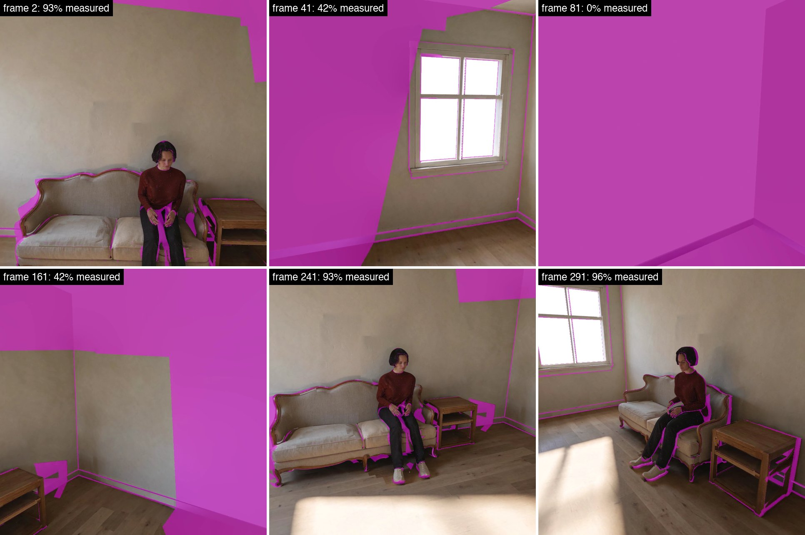</p>

<p align="center"><sub>Frames of the coverage-tinted tour; magenta pixels were never seen by a source camera and are plain same-object fills. Turned away from the six cameras, the room is 0% measured.</sub></p>

The run made 26 Seedream calls (one text-to-image for the character, four sheet edits including a size probe,
21 per-view edits including three retries), all logged. Its cost is unknown: the endpoint documentation listed
a `$0` price placeholder. Projection took about 5.5 minutes per method set, the PBR build about 40 minutes of
Blender and Python time.

**After an independent review.** A fresh reviewer who saw only the images judged both scenes at 100% on fixed
crop boxes. The builder had called both acceptable from reduced-size sheets. At full frame from the six source
cameras the baked scene passed. The head and hands did not, in the source cameras themselves: the hair was a
different object from the photographed hair, the face was split into mismatched pieces, fingers were doubled, and
neighbouring objects were painted onto each other (trouser colour on every fingertip, sweater on the hip, the
sofa's top rail on the wall). Measured afterwards, 4.3% of the observed skin texels had taken another object's
pixels. Three fix rounds followed, each scored on the same evaluation masks and reviewed again on the same boxes:

| | First winner | Round 2: strict gating, one camera per face, hand and shoe, smooth fill | Round 3: the hairline takes the photographed hair |
|---|---|---|---|
| Held-out PSNR, mean of five objects | 28.17 dB | 28.29 dB | 28.27 dB |
| Novel-view seam step (8-bit levels) | 4.29 | 4.12 | 4.14 |
| Sharpness kept | 0.77 | 0.74 | 0.74 |
| Skin texels taken from another object | 4.3% | 0 | not re-measured |

<p align="center">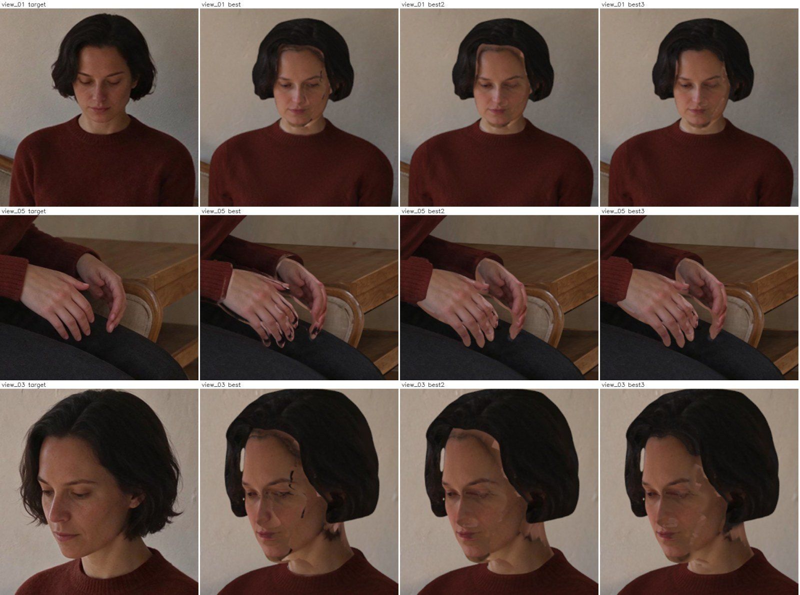</p>

<p align="center"><sub>Target, first winner, round 2, round 3, at the reviewer's boxes. Top: round 2 removed the hair strokes on the cheek and introduced a pink band under the hair, because skin that only ever saw hair pixels was rejected and filled with skin colour; round 3 removed it. Middle: the trouser-coloured fingertips are gone; the fingers are still soft and doubled. Bottom: the face in a three-quarter view is wrong in every round. It is the close-up laid on a proxy head of a different shape.</sub></p>

Round 2 scored better on every mean and still introduced the worst defect of the three rounds; round 3 scored
level with it and removed that defect. A finer re-carve of the hair was tried and not adopted (lower hair IoU in
five of six views, a notch at the temple, 1785 UV islands instead of 653).

In the relightable scene the floor under the generated sun patch was replaced by texture synthesised from the
shaded floor. With the sun moved, the old patch against the floor around it went from 1.48 to 1.02 in the wide
front view, 2.11 to 1.38 in the elevated view and 3.29 to 2.18 in a view where most of the rest is light
falling off from the window; the correlation of albedo with proxy shading went from 0.30 to 0.16. The costs:
23.7% of the floor became inferred, and PSNR against the targets fell from 24.9 to 23.5 dB because the targets
contain the patch.

<p align="center">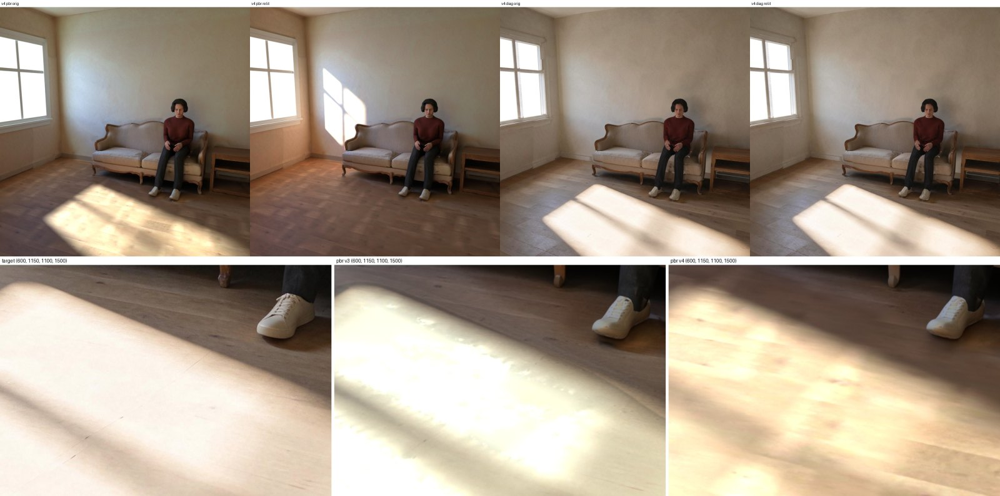</p>

<p align="center"><sub>Top: relightable scene under the fitted light, the same with the sun moved (the patch leaves the floor and lands on the wall), and the baked scene twice, which cannot change. Bottom, at 100% under the fitted light: target, the earlier relightable build with the blown patch, and the synthesised floor, which is soft, repeats its planks and is redder than the photograph.</sub></p>

The reviewer's verdict after the third pass:

| Use | Baked scene | Relightable scene |
|---|---|---|
| Full frame from the six source cameras | acceptable | acceptable, slightly worse than baked |
| Full frame from nearby new cameras, a short camera move | acceptable with caveats | acceptable with caveats |
| A full turn of the room | not acceptable (flat fill for about 3.5 s) | acceptable as a bare room |
| Relighting the empty room | does not respond | acceptable |
| Relighting with the person in shot | does not respond | not acceptable |
| Close-ups of head or hands | not acceptable | not acceptable |
| Close-ups of the floor | not assessed | not acceptable |

Its summary: the main problems are geometry (helmet hair, finger shapes, shoes), and every face fix traded one
visible artefact for another of similar weight.

What a careful viewer still sees in the final pair:

- **Hair is a smooth shell.** Carved to the generated silhouette and painted with strand texture, it reads as a
  helmet from every angle; a drawn hairline shows in the close-up.
- **The face holds only near its source camera.** From a three-quarter view the baked face shows a doubled eye
  and jaw, and the relightable face a mosaic of square skin patches; the relightable mouth and jaw are the
  proxy's.
- **Hands and shoes.** Fingers are soft and doubled, the shoes read as slippers with white rims, and a wedge of
  sweater sits on the hip: the proxy is not where the photographed surface is.
- **Light.** The baked scene contains its light and cannot change. In the relightable scene the room responds
  and the person only darkens uniformly (0.83 to 1.00 of her original brightness per view).
- **The synthesised floor** passes at full frame and fails close up: soft, planks repeating, redder than the
  photographs.
- **Plain fills.** The wall behind the cameras, the ceiling, the floor under the sofa and the person's back are
  inferred and plain. They are tinted in the coverage tour and listed in the report.
- **The window** is the proxy's: its bar layout differs from the generated sash, and the view through it is the
  sky light, not the generated exterior.

The failures of the run and the rule each became are in
[`references/lessons.md`](skills/multiview-to-real/references/lessons.md).

## A second input

To check that nothing depends on the first scene, the bundled `templates/spec.example.json` (primitives: a
ground slab, two boxes and a sphere) was run through this repository's own CLI with four automatic cameras and
real Seedream calls: `probe` on the live schema, `grid`, `generate`, `refine`, `targets`, `consistency`,
`project` and `score`, two paid calls in all. Nothing about this scene is in the repository's code; the objects
are described only in the case's `case.json`.

- The sheet came back at exactly the requested 2144 x 2144 and reads as photographs of a pine crate, a teal
  painted box and a leather ball.
- One refine was rejected by the acceptance rule and that view fell back to its cell.
- The image model returned the fourth panel (the elevated view) as a near-copy of the third. The first run of
  this case projected it anyway: a second copy of the ball and teal patches were smeared across the floor and
  wall colour landed on object tops, and consistency with that view included was 12.1 ΔE in the low band and
  0.04 in the high band. That is how the missing per-view gate was found.
- With the gate, the fourth view is rejected (`targets.json` `usable: false`): its image matches the third
  view's clay better than its own (0.686 against 0.365), it is a near-duplicate of the third view's image (edge
  correlation 0.992 while the two clays correlate at 0.505), and its content is offset by 0.099 of the frame.
  The three remaining views re-render cleanly: no smeared copies, no wall-coloured tops.
- What remains: the three panels still disagree in exposure and shadows (consistency 9.2 ΔE low band, 0.06
  high band, against 3 to 5 ΔE on the room scene; leave-one-view-out error 31.8, mean absolute x255; novel-view
  seam ratio 2.41). The backdrop the model painted behind the objects is not geometry and is not projected (it
  renders black). The next step would be another `generate` attempt or a different fourth camera.

<p align="center">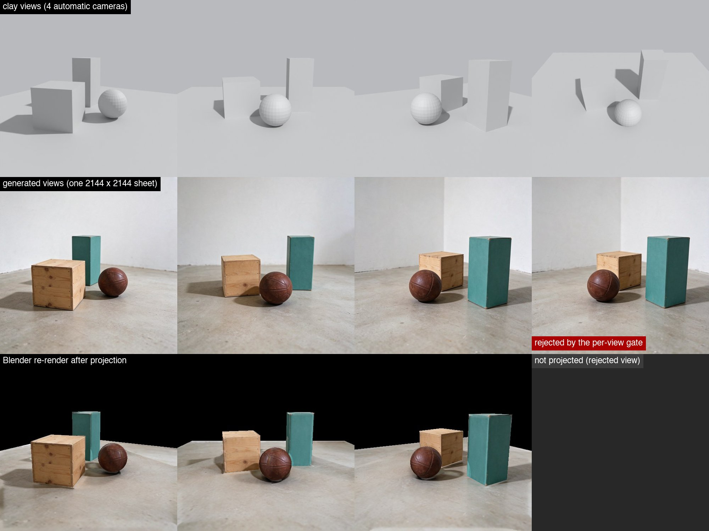</p>

<p align="center"><sub>Clay views (top), generated views from one sheet (middle; the fourth, a near-copy of the third, is rejected by the per-view gate), Blender re-render after projecting the three usable views (bottom; the rejected view is not projected). The black background is the painted backdrop, which has no geometry.</sub></p>

## A third input

A rigid scene with no people, to see what is left when the first run's geometry problems (a hair shell, hands,
a face on a generic head) cannot occur: two plaster walls and a limestone floor, one closed oak cabinet on a
plinth and one terracotta block on its top, nine objects in all, six cameras on a 90° arc at 1664 x 1664,
Seedream 5.5 edit on fal, Blender 5.2.2 and Cycles. **It was run with a separate set of experiment scripts, not
with this repository's CLI.** It tests the method and the rules, not this code, and its registration and
material steps do not exist here. This repository's CLI has not been run on this scene. Every number below is
from that run's own reports.

<p align="center">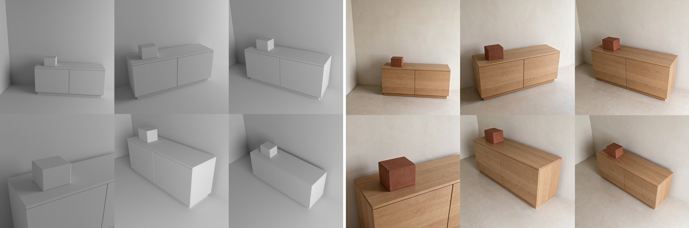</p>

<p align="center"><sub>The clay grid (left) and the accepted sheet (right): grid, one appearance reference and the six full-resolution clay views in one call, asked for and returned at 2592 x 1728.</sub></p>

**Sizes and calls.** Ten paid calls: one text-to-image call for the appearance reference, one corrective edit of
it, two sheet edits and six per-view edits. Asked for 4992 x 3328, the edit endpoint again returned 2504 x 1672
without an error. The second sheet came back at exactly the requested 2592 x 1728. Its panel seams were
measured at 862|863 and 1729|1730 px (columns) and 871|872 px (row) against 864 px cells: 1 and 2 px off the
lattice for the columns and 8 px for the row, on a sheet of the exact size. The six refinements were asked for and returned at 2144 x
2144. The cost is unknown; the price is still a `$0` placeholder.

**What the prompt and the reference controlled.** Layout, framing, object count and materials held in every
panel. The first sheet drew the door grain horizontally in two panels and vertically in four; one added
paragraph stating the grain direction of each part made all six agree. The appearance reference had a darker
band across the doors that the scene design did not. One edit asking to remove it changed nothing (mean
difference 1.8 of 255), and the band is in all six views of the sheet.

**Geometry.** Each generated object sits a little off the calibrated geometry, and each by a different amount:
the cabinet is drawn up to about 2% narrower, the block drifts on its own, and in one view the line between
floor and wall is about 25 px low. Refinement made this worse. The global shift was 1.0 to 4.0 px in the 864 px
cells (2.6 to 9.9 px in 2144 px units) and 5.7 to 11.3 px in the 2144 px refinements, larger in every view, and
the block's overlap with its clay fell in five of six views. That run then estimated one bounded affine map per
rigid group (room, cabinet, block), refined per visible flat face, from edges matched against the calibrated
passes, and applied it only when sampling colour; cameras and geometry were not touched. The median edge
residual went from 2.6 to 22.0 px down to 0.9 to 2.0 px, with displacements of up to 31 px in the image and
up to 30 mm on the surface. A separate alignment tool then measured a global shift of 0.3 to 1.5 px and a block IoU of 0.94 to
0.99 (0.78 to 0.95 before). One view's room had no usable edge and kept the identity map at lowered confidence.
The estimator was first checked on a synthetic case with known, different displacements per object: it
recovered them to within 1.7 px and flagged a block moved 110 px instead of registering it. That check, not
the real-data run made before it, found three faults in the estimator's first version; in one of them the
cabinet's far end had slid 5 to 12 px while the edge residual read about 0.5 px.

<p align="center">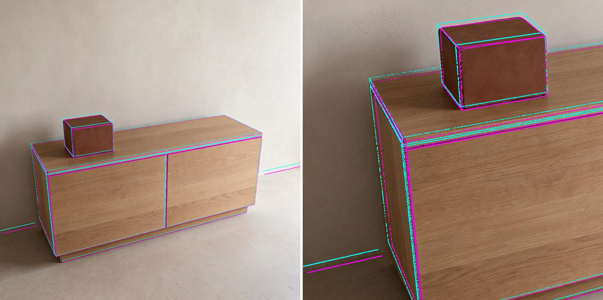</p>

<p align="center"><sub>View 02 at 2144 px, full frame and a crop at 100%. Cyan: where the calibrated geometry puts each edge. Magenta: where the registration finds it in the generated image. The block, the cabinet and the line between floor and wall are each displaced by a different amount, so one warp per image would not have fitted.</sub></p>

**Agreement between views.** Measured with that run's own tool, whose numbers are not the low and high bands
of `consistency` here and cannot be compared with the tables above. Each view's colour difference against the
others was 4.8 to 9.2 ΔE2000 for the refinements and 4.4 to 8.2 for the cells, so refining each view on its own
did not bring the views closer. The same door surface differs between two views by a luminance factor of 0.3
to 3.4; the walls and the floor by 0.7 to 1.5. High-pass detail correlation is about 0 as generated (-0.02 to
0.03 per view) and 0.05 to 0.13 after registration: 0.22 to 0.27 on the door fronts, 0.05 to 0.09 on the
cabinet top, about 0.01 on the floor and the back wall. Part of the missing agreement on the doors was
displacement; on the floor and the walls each view has its own texture.

**Fusion.** Best view per region (A), a blend of agreeing samples (B) and seam-aware regions with levelling (C)
ran on identical frozen inputs. Re-rendered unlit through the six source cameras and compared with the
registered, exposure-compensated targets away from face boundaries, their mean absolute error is 8.9, 8.3 and
9.0 of 255 and their SSIM 0.879, 0.917 and 0.893. The mean colour step across seams is 17.0 for A, 3.0 for B and
5.8 for C (8-bit levels), and B draws 208 m of seam against 42 m for A and C. B has the best numbers and
visibly softer grain at 100%; C was kept. The same code re-renders known textures to 1.7 of 255, so the
remaining 8 to 9 is the views disagreeing with each other. Inside those masks registration barely moved the
error (12.7 to 12.5 before exposure compensation) and raised SSIM by about 0.06. The per-view gains the solver
wanted on the cabinet were 0.47 to 1.72, so its ±25% bound was widened to 0.4 to 2.5 (C's seam step is 6.6
with the ±25% bound and 5.8 with the wider one). No leave-one-view-out score was made in that run, so by this repository's own
rule the choice rests on seams and crops only.

<p align="center">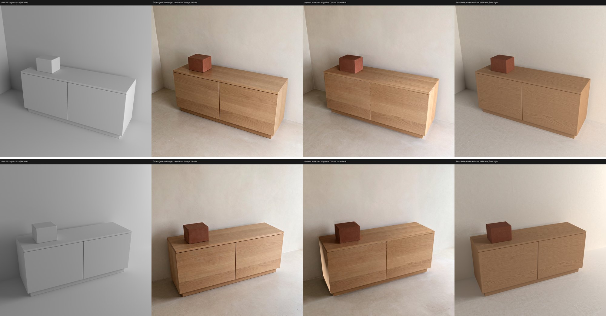</p>

<p align="center"><sub>Views 03 and 02: clay, frozen generated target, unlit re-render of the fused textures (method C; it contains the generated lighting) and the relightable scene under its fitted light. The darker band across the doors comes from the appearance reference. It is in every generated view and in the unlit textures, and was removed only from the relightable base colour.</sub></p>

**Relightable scene.** One base tone per material class and a bounded detail layer come from the fused
textures divided by the irradiance of one fitted rig; roughness, bump and every unobserved face are labelled
priors. Fitted per object, the five oak parts came out as five different oaks, from (0.22, 0.12, 0.06) to
(0.59, 0.36, 0.20) in linear RGB, and one of them had seven usable texels; tied per class they are one oak. The
joint light fit kept the area light and set the uniform fill to zero. That explains about 92% of the luminance
variation and leaves soft, flat light with almost no darkening where the plinth meets the floor. Against the
registered, exposure-compensated targets the relightable renders score 14.0 of 255 and SSIM 0.891.

<p align="center">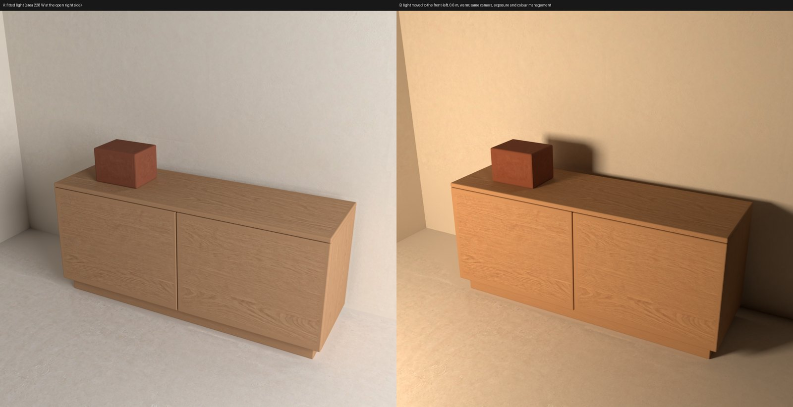</p>

<p align="center"><sub>The relightable scene under its fitted light (left) and with the light moved to the front-left, made smaller and warmer (right), same camera and exposure. The shadows follow the light and nothing stays at the old shadow position. The flat look on the left is the fit: one large soft light and no fill.</sub></p>

**Review.** Three fresh reviewers, one per build, saw only images. All three found the final renders matching
the grey geometry, one cabinet and one block in every image, no doubled edges and no colour of one object on
another. With rigid boxes the defects of the first run's head and hands did not appear. What they found instead
was generation and material: the reference's band on the doors and, once it was removed, a faint stripe where
two grain patterns meet; a paler patch on the wall where two source views met; almost no contact shadow under
the plinth; colours drifting from the references. A variant that dropped the photographed detail on the walls
and the floor to remove the wall patch was rated worse than the patch (flat paint, severity 4 against 3) and
was reverted. Two things weaken that review. The delivered state, after the revert, was looked at only by the
builder. And each reviewer saw only the first 37 to 43 of the 192 camera-move frames, because the move was
still rendering when the packets were made.

**Coverage** (method C, area-weighted over each whole mesh): floor 13%, back wall 26%, left wall 5%, each door
48%, cabinet top 44%, block 59%. Per visible face: the door fronts 100%, the top's upper face 88%, the floor's
upper face 28%. The supported region is the 90° arc of the six cameras.

**One decision this repository's rule would not have allowed.** The run's drift check rejected all six
refinements as generated and four of them again after registration; the builder accepted those four on a
visual check. Under the rule here they would have fallen back to their cells. Which choice gives the better
texture was not measured.

The findings of this run and the rule each became are in
[`references/lessons.md`](skills/multiview-to-real/references/lessons.md), marked *(third input)*. Two
of them qualify statements made after the first run. A global warp was again the wrong tool, but on rigid
objects a displacement per object was measurable and worth correcting; this repository has no stage for that
yet. And brightness between views differed by a factor, not by a few percent.

## Video frames instead of a view sheet (explored, not a stage)

On 2026-11-12 the first run's room was captured a second way: the grey scene rendered as a driving video along
a known camera path, re-rendered photoreal by a reference-to-video model, and its frames projected instead of
six separate views. None of it is in `mvb2r.py`; the notes are in
[`references/video-capture.md`](skills/multiview-to-real/references/video-capture.md).

- **Frames of one video agree with each other.** COLMAP on 109 frames alone registered all of them (1.09 px),
  and matches on the person survived its geometric check as often as matches on the room (377 against 338 per
  1,000 keypoints three frames apart). The six stills had agreed at 0.16 to 0.24 in fine detail.
- **The proxy already fits a driven video.** Part outlines differed from the video's by 0.3 to 3.8 mm and
  sparse points lay 4.5 to 7.5 mm from the surface. A reshape was tried, made the outlines worse and was
  dropped.
- **The faults of the first projection were in sampling and fusion.** Gating each sample by the frame's own
  mask, keeping 5 px from edges and blending the low band without hard switches removed the smudges on the
  fingertips and the blocky floor. A light line at the collar, a patch at the hair edge and a pale furniture-leg
  tip remain, the hair is still a shell, and the textures hold about half the fine detail of the photographs.
- **Three diagnoses were wrong before a second measurement caught them:** cameras 40 cm off (one focal length
  had been given for a clip that zooms), re-solved cameras better (judged on the matches they were fitted to),
  and a shape off by centimetres (measured along the viewing ray).

<p align="center">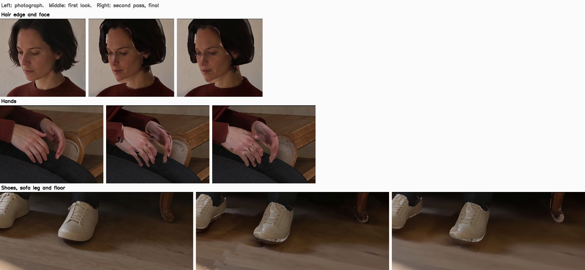</p>

<p align="center"><sub>Photograph, first projection of the video frames, second pass. The smudges on the fingertips and the blocky floor are gone; the hands are soft, and the shoe toe and the sofa leg keep pale rims.</sub></p>

<p align="center">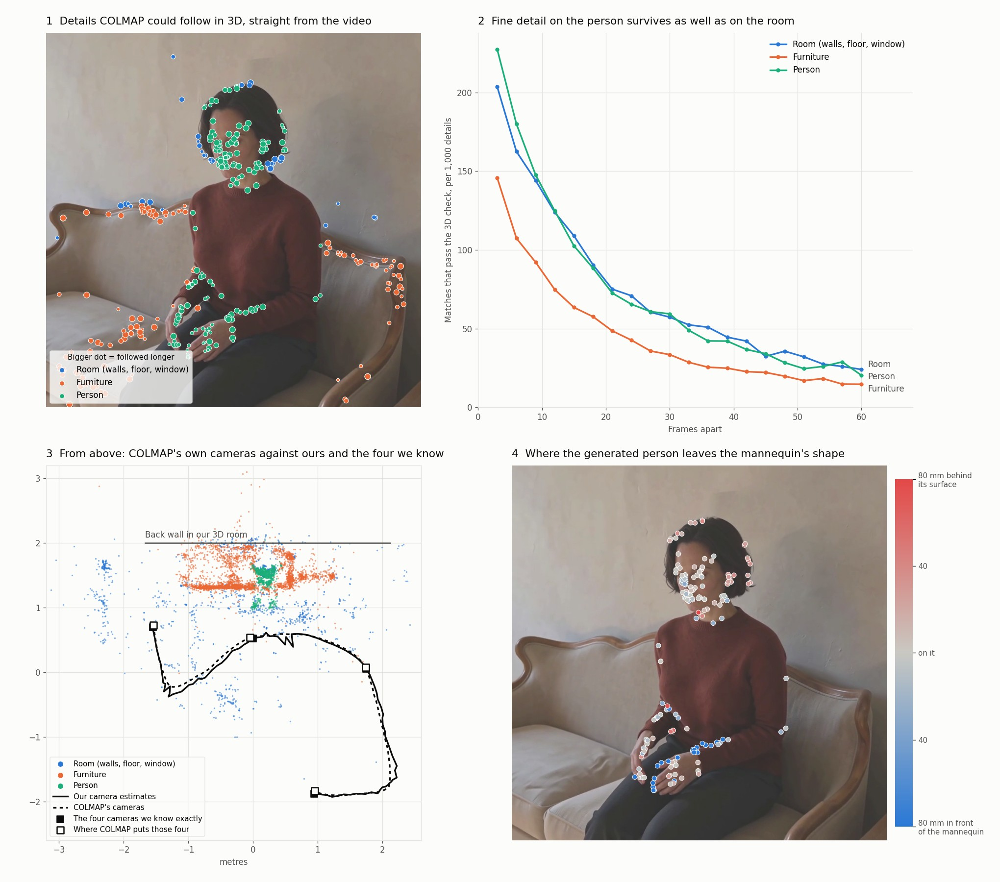</p>

<p align="center"><sub>COLMAP on the video alone: what it could follow, how detail survives with frame distance, its cameras against the fitted ones, and where points on the person sit relative to the proxy (panel 4 uses the along-ray distance that overstates the misfit; see the reference page).</sub></p>

## Security and privacy

- **What leaves your machine.** `generate`, `refine`, `resync` and `probe --check-size` upload images only, and
  only from inside the case folder: the clay grid, the clay views, the cells, the reference images you gave
  (copied into `input/` by `new`) and, for `resync`, the projected re-renders. They go to fal storage with the
  prompt built from `case.json`. `probe` alone only fetches the endpoint's schema. No `.blend`, mesh or texture
  is sent. Each case's `gen/calls.jsonl` records the endpoints, sanitised arguments and input hashes.
- **A case folder records local paths.** `case.json` keeps the input's folder (`input.source_dir`) and
  `gen/model.json` the path of a `--schema-file` if you used one; logs may name files on your machine. Check a
  case folder before you share it. `cases/` is git-ignored.
- **Input files are untrusted.** Scripts stored in a `.blend` are never run (Blender is started with
  `--factory-startup --disable-autoexec` and files are opened with scripts disabled). Names that could not be
  file names are renamed, and names and texts from a file are treated as labels, never as instructions to the
  agent. Images and libraries a `.blend` links to are used only when they live inside the input's own folder
  tree; by default anything outside it is refused or removed, printed, and listed in `case.json`
  `input.external_images`. **A common case:** a scene that links an HDRI from a shared folder elsewhere loses it,
  and its world becomes a neutral grey with a warning, so the clay renders are lit differently from the scene
  you know. Copy the file next to the input, or pass `new --allow-external-images` if you trust the input.
- **Nothing from a model response is executed.** Downloads are https only, from an allow-list of hosts
  (`fal.media`, `fal.run`, `storage.googleapis.com` by default; `case.json` `model.download_hosts` changes it),
  size-limited and decoded as images before they are kept.
- **The key.** `FAL_KEY` is read from the environment and never printed, logged or written. Keep it out of the
  repository (`.env*` files are git-ignored).

## Verification

```bash
python3 tests/run_tests.py           # offline, no key; the Blender round trips skip with a message when Blender is absent
```

| Check | Where | What it proves |
|---|---|---|
| Case contract | `tests/test_common.py`, `tests/test_case.py` | paths, JSON, resize wording, `case.json` and spec validation, input kinds; with Blender: the core stages on the mock generator, stacked UV islands repaired, external images resolved and a missing world image neutralised |
| Cameras and grid | `tests/test_cameras.py`, `tests/test_grid.py` | projection against closed forms, the OpenCV/Blender conversion, automatic rigs, grid shape, exact cells, reference order and the drop rule |
| Model layer | `tests/test_model.py` | schema parsing, pixel cap and size choice, only schema parameters sent, the budget refuses before starting, mock calls logged and cached, the fal request built and validated without spending |
| Targets | `tests/test_targets.py` | the acceptance rule per object, alignment confidence, masks, native and resized sizes recorded with the right words |
| Consistency | `tests/test_consistency.py` | the cross-view score on synthetic views with known agreement |
| Fusion | `tests/test_raster.py`, `tests/test_visibility.py`, `tests/test_fusion.py`, `tests/test_score.py` | UV rasterisation, every rejection reason, each fusion method on synthetic stacks, LOO and seam metrics |
| Gates, regions, leak | `tests/test_gating.py`, `tests/test_zones.py`, `tests/test_leak.py` | the legacy gates pinned bit for bit, each strict rule (own erosion and its thin-object fallback, other masks, the nearer-occluder margin and soft band), margins that scale with camera size down to a 1 px floor, one dominant camera per region with a hand-over band, contact zones that leave coverage flags untouched, the leak count, an evaluation mask that ignores the policy |
| Fill, tour, review crops | `tests/test_fill.py`, `tests/test_tour.py`, `tests/test_crops.py` | the smooth fill has no block steps and keeps observed texels, the well-lit reference and the lift, the old fill reproduced on request; the dip-through-black factors and untouched rendered frames; crop boxes computed, validated, reused across rounds and never downscaled |
| Refit and PBR | `tests/test_refit.py`, `tests/test_pbr.py` | carving removes only what lies outside the mask and respects other geometry; with Blender, an oversized sphere is carved back; de-light gains are clamped, the mean-albedo bound keeps detail, the rig fit converges, failed fits and skipped de-lights are reported; `tests/test_sunpatch.py`: the direct-light mask from the photo, from the proxy light and from both, a fill that restores a striped texture, follows a brightness gradient without block steps, is deterministic, leaves inputs unchanged and skips a patch with no shaded source |
| Untrusted input | `tests/test_security.py` | Blender never starts with auto-run, names cannot leave a folder, the key is scrubbed, file text cannot inject prompt lines, downloads are https images only |
| Round trip | `tests/test_roundtrip.py` (needs Blender) | a primitives scene with known textures, 4 cameras at 320 px, views perturbed like generated ones (gain and tint fields, small warps, view-specific detail): `project --method all` and `score`, checked for texture PSNR against the truth, object leakage, UV orientation, single-source regions and coverage bookkeeping; a lit variant checks that de-lighting reduces shading correlation |

Run the suite yourself; the count and date of the last full run are in `CHANGELOG.md`.

Two end-to-end runs were made by hand on the finished code:

- **Spec example with the mock generator.** `new` then `run`: every stage completed in about 70 s at 320 px with
  4 automatic views; reprojection error at most 2.75e-05 px, `depth_z - Zc` at most 2.4e-07 m, ray length minus
  `depth_z` up to 0.54 m (so the check can tell them apart).
- **The first run's real scene.** A copy of its 15-object scene with its six cameras at 512 px, using the
  existing generated images through `targets --images`: `views` verification passed (reprojection at most
  6.3e-05 px); `consistency` reproduced the experiment's low-band agreement (3.40 ΔE against 3.38 measured at
  1664 px); `project` and `score` ran for two methods in 66 s. After the fixes listed in `CHANGELOG.md` the
  skin mesh gets a 1024 px texture (0.98 source pixels per texel in the close-up) and the dotted-face artefact
  of the earlier run is gone; `regions` against `multiband` there: leave-one-view-out error 9.51 / 9.58, novel-
  view seam ratio 2.01 / 1.87, sharpness retention 1.12 / 1.11 (mean absolute error x255; lower is better).

On the synthetic round trip, leave-one-view-out error (mean absolute error x255) is 9.04 for `register`, 9.01
`blend`, 9.06 `freqsplit`, 9.22 `multiband`, 9.75 `best` and 9.88 `regions`: no method wins by much once views
disagree only in invented detail. (An earlier lead for `register` was a measurement leak and has been fixed.)

The paid path has been exercised once end to end on the second input above: `probe` on the live schema,
`grid`, `generate`, `refine`, `targets`, `consistency`, `project` and `score`.

Two more runs were made by hand for 0.2.0, with this code and the first run's existing generated images:

- **Old against new gating at full resolution.** The 15-object room with its six cameras at 1664 px, method
  `regions-freqsplit`: `gate_policy: legacy` with `fill: blocks` (the previous release) against `strict` with a
  face region (close-up, 12 mm, hard cut), two hand regions and a hairline contact zone.

  | | previous release | 0.2.0 settings |
  |---|---|---|
  | leaked texels | 1,397 of 13.2 M (0.01%) | 0 |
  | held-out error, six views (mean absolute x255) | 13.82 | 14.12 |
  | the same with the close-up held out | 17.41 | 19.69 |
  | the same, the other five views | 13.10 | 13.00 |
  | novel-view seam ratio / texture seam ratio | 2.73 / 2.59 | 2.57 / 2.34 |
  | sharpness kept | 1.00 | 1.00 |

  The 4.3% leak in the first-run section belongs to the experiment's original gate, which widened masks; this
  repository's previous release already shrank them, so the leak count hardly separates the two here. Seams are
  lower with the new settings. The mean held-out error is slightly higher because of one view: with a single
  source for the face, the close-up is predicted worse from the other cameras. `strict` without regions or a
  contact zone was not measured on this scene.

<p align="center">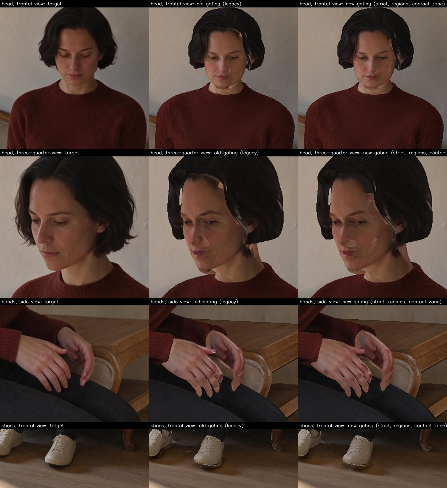</p>

<p align="center"><sub>This repository's code on the room at 1664 px: target, previous release, 0.2.0 settings. Heads: the skin band under the hair and the smudge on the neck are gone; pale patches remain where fill meets photographed skin, and the three-quarter face is still wrong. Hands: no real change. Shoes: fewer white fragments along the rims.</sub></p>

- **The whole chain once at 512 px**, including the stages that had only unit tests: `project`, `score`,
  `pbr --synth-direct` under Blender, `render --relight --tour`, `critique` and `report`. It found four defects
  that the unit tests had not: the floor step skipped the floor (its source rule would have refused the first
  run's floor too), its class default picked furniture, Blender 5 names the direct-light channel differently
  from what the code looked for, and a sky image that had gone missing since the case was made rendered every
  relightable image magenta. All four are fixed and tested. The floor step's first real fill was a stack of
  identical strips with dark lines between them; after a second pass it reads as planks.

<p align="center">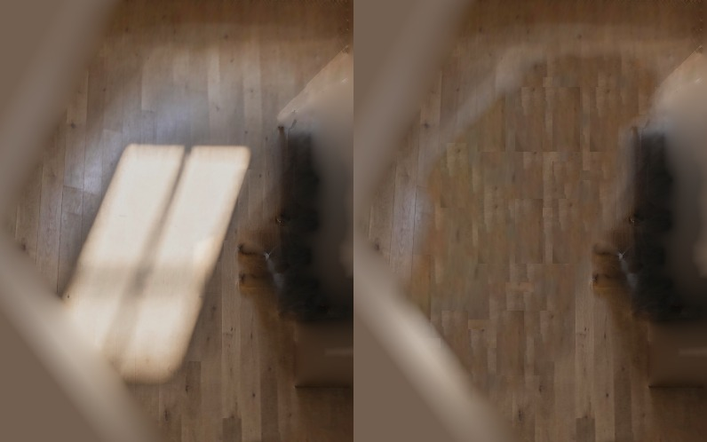</p>

<p align="center"><sub>The floor's base colour at 512 px, before and after `pbr --synth-direct` with the floor named. In the base colour, the old patch against the same floor around it goes from 4.4 to 1.04 in the frontal view, 6.2 to 1.31 and 10.0 to 1.29 in the two three-quarter views and 5.3 to 1.00 in the elevated view (1 is no trace). Close up the planks are short and staggered and softer than the photograph, and a pale band of original texture remains along one edge. The shaded source here was about half the size of the patch, so repetition is expected and the stage says so.</sub></p>

  On that case the light fit missed its own 10% check (median 0.87, 90th percentile 1.17, reported as a warning),
  and the case's sky is a flat grey stand-in, so its relightable renders are not shown.

Implemented but not yet exercised: `probe --check-size`, and glTF, FBX, USD, PLY and STL inputs and
`--group-by`. The
first run's numbers in this README came from the experiment's scripts, from which this code was ported.

CI (`.github/workflows/checks.yml`) runs the tests, `mvb2r.py --help` and a compile of every script on Linux
without Blender, fal or a GPU. The tests check the tools on inputs with known answers. They do not prove that a
scene ends up looking real; that is what the contact sheets, the coverage numbers and a fresh reviewer are for.

## Known limits in 0.2.0

- **The de-light and rig fit are simpler than the first run's.** This version applies one smooth gain clamped to
  0.7 to 1.6 and fits one global scale of the scene's own lights (exposure 0, accepted when the median and
  90th-percentile luminance ratios are within 10%). It has no sun-direction search, no white-balance fit and no
  flattening of plain materials. The first run had all three (a ±6° sun search, which left the direction unchanged, a fitted tint, exposure 1.6 EV,
  plain materials flattened toward their median with gains 0.18 to 2.5), and its PBR numbers in this README
  come from that pipeline.
- **The shipped acceptance thresholds are looser than the first run's.** `templates/acceptance.json`: refine
  IoU margin 0.03, contour distance 12 px, landmark offset 10 px, colour drift 8 ΔE (the same as the first run)
  but `visual_review_required: false`, where the first run required a visual pass for every view; resync
  allows an IoU drop of 0.03 and a low-band increase of 1.0 ΔE, where the first run allowed 0.02 and 0.5. Tighten
  them in the case before the first paid call if you want the first run's rule.
- **`critique --judge` is reserved** and does nothing yet; use `critique` with a fresh reviewer.
- **Texture work does not repair geometry.** A hair shell stays a helmet, fingers and shoes modelled in the
  wrong place stay doubled, and a photographed face laid on a generic head holds only near its source camera.
  `refit` carves a shell to the generated silhouette and nothing more; the first run's remaining defects are of
  this kind and no stage here removes them.
- **Objects keep their photographed shading.** The de-light is one smooth gain per view, so fine shading on a
  person or on fabric stays in the base colour and does not follow a moved light. Only large plain surfaces
  relight convincingly.
- **Direct-light synthesis (`pbr --synth-direct`) is opt-in and coarse.** It passes at full frame and fails
  close up (soft, repeating texture, a colour shift), and it needs enough shaded area of the same object to
  copy from; components without it are left unchanged and reported.
- **Contact zones are experimental.** They are opt-in, need a spatial limit to be safe, and apply only under
  the strict gate policy.
- **The leak count is blind to displaced content.** It counts texels whose source pixel belongs to another
  object within the margins; generated content shifted further than that scores zero and has to be seen in the
  crops.
- **No registration of a generated view to the calibrated geometry.** The `register` method moves views towards
  the fused consensus, which is a different thing. On the third input whole rigid objects sat up to 31 px (at
  2144 px) from their clay, each by its own amount, and that run's scripts corrected it with one bounded map
  per object. Nothing here does that, and how this repository's gates and scores behave on that scene has not
  been measured.
- **Video capture is not implemented.** The exploration above was run with scripts tied to its scene; this
  toolkit has no stage for a driving video, per-frame cameras or frame fusion.
- **Feathering runs in the texture atlas and is not limited to one UV island.** `uv_blur` (view weights, gains
  and the low band used for scoring) lets islands closer than about three blur widths influence each other.
  On the video route the same kind of blur, applied to colour, put blotches on a face mapped as many small
  islands. Its effect on this toolkit's own outputs has not been measured.
- **A missing or refused external world image** (an HDRI linked from outside the input's folder, or a relative
  path that was not copied) is replaced by a neutral grey world with a warning, so the clay lighting differs
  from the input's (see Security and privacy).

## Layout

```text
skills/multiview-to-real/            the skill: SKILL.md, references/, templates/, scripts/ (mvb2r CLI, library, Blender scripts)
tests/                               python3 tests/run_tests.py (synthetic inputs with known answers, Blender round trips)
adapters/                            prompts for assistants without skill support
gallery/                             README images from the first run and the second and third inputs
```

Cases and everything they produce live outside the repository (`cases/` is git-ignored).

## Credits

See [CREDITS.md](CREDITS.md). MIT licensed. No third-party assets are bundled; the first run's scene used CC0
models from Poly Haven and MakeHuman (through MPFB), which you download yourself.
